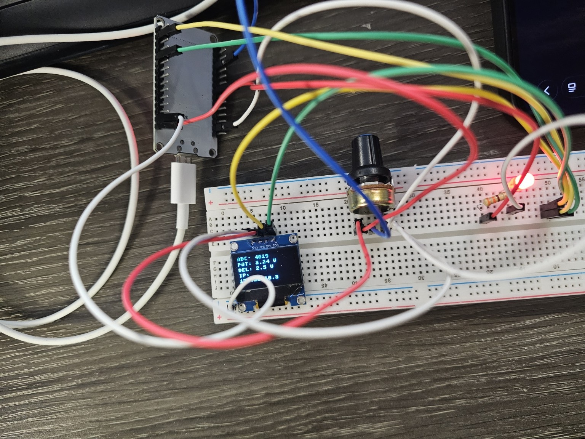

# ESP32 — Conversion analogique numérique et commande d’une DEL

Projet réalisé en équipe par **Maryem Belouaar et Khalid Asseffar**, à l’Institut Grasset, dans le cours **420-PC6-AG — Programmation d’objets connectés**, avec Fernando Ribeiro Trovão.

L’ESP32 mesure la tension d’un potentiomètre, affiche la mesure sur un écran OLED et héberge une page web pour régler la luminosité d’une DEL. Le programme est écrit en **MicroPython** et utilise **uasyncio** pour faire fonctionner la mesure, l’affichage et le réseau de façon coopérative.

## Aperçu du montage



## Fonctionnalités

- Lecture du potentiomètre sur GPIO34 avec un CAN de 12 bits, de 0 à 4095.
- Conversion nominale de la mesure en volts.
- Affichage de la valeur brute, de la tension du potentiomètre, de la consigne de la DEL et de l’adresse IP sur un OLED SSD1306 de 128 × 64 pixels.
- Commande de la DEL sur GPIO25 par un signal PWM à 1 000 Hz.
- Page web locale avec sept consignes : 0, 0,5, 1, 1,5, 2, 2,5 et 3,3 V.
- Rejet des consignes invalides sans modifier la DEL.
- Surveillance du Wi-Fi et tentatives de reconnexion, avec poursuite de la tâche de mesure.

**Le potentiomètre et les boutons web ont des rôles indépendants** : le potentiomètre fournit la mesure analogique ; les boutons règlent la DEL.

## Matériel et branchement

Matériel prévu : ESP32, écran OLED SSD1306 I2C, potentiomètre linéaire de 10 kΩ, DEL, résistance série de 220 à 330 Ω, plaque de prototypage, fils et câble USB de données.

Débrancher le câble USB avant de modifier le montage.

| Composant | Connexion à l’ESP32 |
|---|---|
| OLED SDA | GPIO21 |
| OLED SCL | GPIO22 |
| OLED VCC et GND | 3V3 et GND |
| Potentiomètre, extrémités | 3V3 et GND |
| Potentiomètre, patte centrale | GPIO34 |
| DEL, anode via la résistance | GPIO25 → résistance → anode |
| DEL, cathode | GND |

Toutes les masses sont communes. Le programme utilise l’adresse I2C **0x3C** et une fréquence de bus de **100 kHz**. Le potentiomètre doit être alimenté en **3,3 V**.

## Démarrer avec Thonny

1. Installer MicroPython adapté au modèle de l’ESP32 si nécessaire, puis brancher la carte par USB.
2. Dans Thonny, sélectionner **MicroPython (ESP32)** et le port série de la carte.
3. Copier `code/main.py` et `code/ssd1306.py` à la racine de l’ESP32.
4. Copier `code/config_example.py` sur la carte sous le nom **`config.py`**, puis compléter localement les identifiants Wi-Fi :

   ```python
   WIFI_SSID = "NOM_DU_RESEAU"
   WIFI_PASSWORD = "MOT_DE_PASSE"
   ```

5. Ouvrir `main.py` sur la carte et lancer avec **F5**. Le nom `main.py` permet également le démarrage automatique après une réinitialisation.
6. Attendre la connexion et relever l’adresse IP affichée sur l’OLED ou dans la console.
7. Depuis un téléphone ou un ordinateur connecté au même réseau local, ouvrir **`http://ADRESSE_IP/`**.
8. Tourner le potentiomètre pour observer la mesure, puis essayer les boutons web pour commander la DEL.
9. Arrêter avec **Ctrl+C** ou le bouton Stop de Thonny. Le bloc `finally` remet alors le PWM à zéro lorsque l’arrêt normal du programme le permet.

Le programme utilise les modules MicroPython `machine`, `network`, `time`, `uasyncio` et le pilote `ssd1306.py` fourni. Le serveur écoute sur le **port 80** ; la page ne charge pas de ressources externes.

**Ne pas publier `config.py`** : il contient les identifiants du réseau. Seul le modèle sans véritables identifiants est inclus dans le dépôt.

## Conversions

### Analogique vers numérique

```text
Vpot = valeur_brute × 3,3 / 4095
```

Par exemple, une lecture de 2048 correspond à environ **1,65 V** selon cette conversion nominale. L’affichage de deux décimales ne garantit pas une précision réelle de 0,01 V : l’ADC et son étalonnage influencent la mesure.

### Consigne vers PWM

```text
duty = arrondi(Vconsigne × 1023 / 3,3)
```

| Consigne | Valeur PWM |
|---|---:|
| 0 V | 0 |
| 0,5 V | 155 |
| 1 V | 310 |
| 1,5 V | 465 |
| 2 V | 620 |
| 2,5 V | 775 |
| 3,3 V | 1023 |

La consigne en volts représente une **moyenne nominale du signal PWM**. Elle ne correspond pas à une tension continue mesurée aux bornes de la DEL.

## Routes du serveur

| Requête | Comportement |
|---|---|
| `GET /` | Affiche la page de commande — HTTP 200 |
| `GET /set?v=1.5` | Applique la consigne de 1,5 V — HTTP 200 |
| `GET /set?v=7` ou `/set?v=abc` | Refuse la consigne et conserve l’état précédent — HTTP 400 |
| Chemin inconnu | HTTP 404 |
| Méthode différente de GET | HTTP 405 |

Les valeurs acceptées correspondent exactement aux chaînes indiquées dans `valeurs_valides`.

## Organisation du programme

| Fonction ou tâche | Rôle |
|---|---|
| `convertir_adc()` et `lire_potentiometre()` | Lire la valeur brute et calculer la tension |
| `convertir_pwm()` et `regler_del()` | Convertir puis appliquer la consigne |
| `afficher_oled()` | Actualiser l’écran |
| `tache_mesure()` | Planifier la mesure et l’affichage, avec une période nominale de 200 ms |
| `connecter_wifi()` | Surveiller le réseau et retenter une connexion toutes les 20 s en cas de besoin |
| `traiter_chemin()` | Valider les requêtes et sélectionner la réponse |
| `traiter_client()` | Lire et traiter un client HTTP avec des délais bornés |
| `tache_serveur()` | Ouvrir ou fermer le serveur suivant l’état Wi-Fi |
| `main()` | Lancer les trois tâches avec `asyncio.gather()` |

Les en-têtes HTTP sont limités à **1 024 octets**. Le programme prévoit au maximum **trois clients actifs** et des délais de **deux secondes** pour la lecture et l’envoi. Les tâches sont coopératives ; leur cadence réelle doit être vérifiée sur le matériel.

## Fichiers du dépôt

- [`code/main.py`](code/main.py) : programme principal asynchrone.
- [`code/ssd1306.py`](code/ssd1306.py) : pilote de l’écran OLED.
- [`code/config_example.py`](code/config_example.py) : modèle de configuration Wi-Fi.
- [`Documentation_technique.pdf`](Documentation_technique.pdf) : rapport technique avec branchement, calculs et fonctionnement.
- [`Presentation_ESP32.pptx`](Presentation_ESP32.pptx) : présentation du projet.
- [`photos/`](photos/) : photos du montage et de la démonstration.
- [`reference/test_complet_original.py`](reference/test_complet_original.py) : version antérieure conservée à titre de référence ; utiliser `code/main.py` pour la version asynchrone.

## Démonstration et vérifications

Les photos fournies montrent notamment des consignes de **1,5 V** et de **2,5 V**, ainsi que la manipulation du potentiomètre. Le rapport distingue ces observations des essais restant à confirmer sur la version asynchrone.

Pour vérifier le projet sur la carte :

1. Tourner le potentiomètre et observer la valeur brute ainsi que la tension sur l’OLED.
2. Essayer les sept consignes web et observer la DEL.
3. Envoyer une consigne invalide et vérifier que la luminosité reste inchangée.
4. Couper puis rétablir le Wi-Fi et vérifier la poursuite de l’affichage puis la reprise du serveur.

**Limite de validation :** la documentation mentionne des vérifications sur ordinateur avec composants simulés. La version corrigée doit aussi être essayée sur l’ESP32 ; les photos seules ne prouvent pas tous les scénarios.
